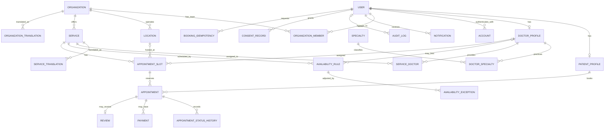
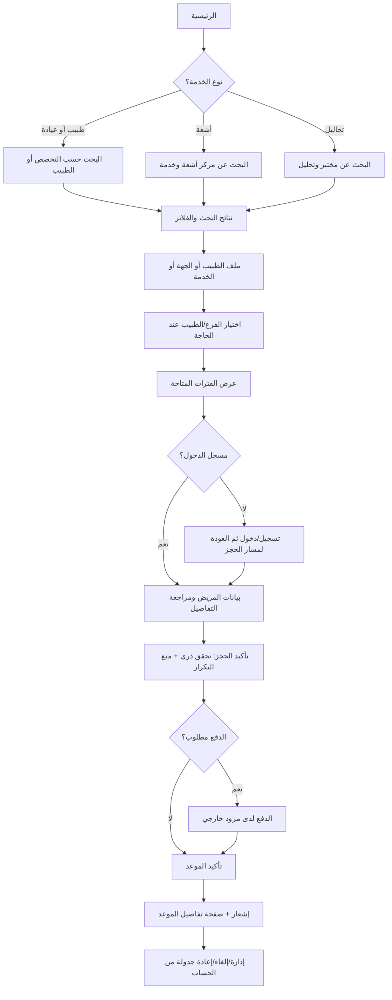

# منصة حجز المواعيد الطبية

> وثيقة المشروع ومخرجات المرحلتين الأولى والثانية: المعمارية، هيكل المجلدات، نموذج البيانات، الصفحات، تدفقات المستخدم، ومخطط Prisma قابل للتحقق.

منصة متعددة الجهات لحجز الاستشارات الطبية ومواعيد العيادات وخدمات الأشعة والتحاليل، مع واجهتين عربية/إنجليزية ودعم RTL/LTR. هذه الوثيقة هي نقطة الانطلاق قبل تنفيذ الميزات؛ وهي تفترض إطلاقاً أولياً على هيئة **Modular Monolith** مع حدود وحدات واضحة، بحيث يمكن فصل خدمات مستقلة لاحقاً عند وجود حاجة تشغيلية مثبتة.

## 1. قرارات تقنية ومعمارية

| القرار | الاختيار | السبب |
|---|---|---|
| تطبيق الويب والـ API | Next.js App Router (14 أو أحدث بإصدار أمني مدعوم) + TypeScript | مشاركة أنواع التحقق، Server Components للصفحات المقروءة، وRoute Handlers كواجهة API أولية تقلل تعقيد النشر. |
| تنظيم الخادم | Modular Monolith + Clean Architecture | إطلاق وتشغيل أبسط من خدمات مصغرة، مع إبقاء الـ Domain مستقلاً عن Next.js وPrisma لتسهيل الاختبار والاستخراج لاحقاً. |
| قاعدة البيانات | PostgreSQL + Prisma | معاملات قوية للحجز، علاقات وقيود مرجعية، ومخطط قابل للتطور. تستخدم migrations SQL للقيود المتقدمة غير المعبّر عنها بالكامل في Prisma. |
| المصادقة | Auth.js / NextAuth مع JWT | جلسات عديمة الحالة مناسبة لتطبيق الويب؛ تظل صلاحيات كل مورد مفحوصة على الخادم ولا يُعتمد على الدور الموجود في الواجهة. |
| التحقق | Zod + React Hook Form | مخطط تحقق مشترك للمدخلات، مع إعادة التحقق دائماً في حدود الخادم. |
| الحالة | Zustand للحالة التفاعلية المؤقتة فقط | حالة خطوة الحجز/واجهة البحث مناسبة للمتجر؛ بيانات الحساب والمواعيد والنتائج مصدرها API/الخادم وليست نسخة موثوقة في المتصفح. |
| الواجهة | Tailwind CSS + shadcn/ui + Framer Motion | مكونات قابلة للوصول والتخصيص، مع حركة معتدلة واحترام `prefers-reduced-motion`. |
| التدويل | مسارات `/{locale}` ومكتبة مثل `next-intl` | فصل رسائل الواجهة عن المحتوى، تحديد الاتجاه من اللغة، وإتاحة روابط قابلة للمشاركة. |
| المواعيد | UTC للتخزين + منطقة زمنية IANA لكل موقع | تجنب أخطاء التوقيت الصيفي؛ يُعرض الموعد في المنطقة المحلية للعيادة مع حفظ اللحظة الزمنية UTC. |

**اختيار API Routes بدلاً من NestJS في المرحلة الأولى:** يقلل عدد التطبيقات وعمليات النشر، مع عزل Use Cases وRepositories بحيث يمكن نقل طبقة العرض/API إلى NestJS لاحقاً دون نقل منطق المجال. إذا تطلبت المنصة لاحقاً معالجة خلفية كثيفة أو فريقاً مستقلاً للـ API، يكون NestJS خياراً لاستخراج الوحدة مع الإبقاء على عقودها.

## 2. حدود النظام والوحدات

- **Identity & Access:** تسجيل الدخول، JWT، الأدوار، وربط المستخدم بملف مريض/طبيب.
- **Provider Directory:** العيادات والمراكز والفروع والأطباء والتخصصات والخدمات والترجمات.
- **Scheduling:** قواعد الدوام والاستثناءات وتوليد الفترات المتاحة وإدارتها.
- **Booking:** التحقق من صلاحية الموعد، الحجز، الإلغاء، إعادة الجدولة، وسجل الحالات.
- **Payments:** تسجيل محاولات الدفع وحالاتها وتكامل مزود دفع خارجي عند تفعيله.
- **Notifications:** إشعارات البريد/الرسائل؛ الإرسال الفعلي عبر Queue/Worker وليس داخل طلب HTTP الحرج.
- **Reviews:** تقييمات مرتبطة بحجز مكتمل، مع مراجعة إساءة الاستخدام.
- **Administration:** مراجعة الجهات ومراقبة التشغيل وإدارة الصلاحيات.

### قواعد معمارية

1. يعتمد `domain` على TypeScript القياسي فقط، ولا يستورد Prisma أو Next.js.
2. حالات الاستخدام في `application` تستقبل واجهات Repository وClock/ID generator كاعتمادات.
3. التنفيذ الفعلي للواجهات في `infrastructure` (Prisma، البريد، الدفع، التخزين).
4. `app/api` طبقة نقل رقيقة: مصادقة، parsing، استدعاء Use Case، وتحويل الأخطاء إلى HTTP. لا تضع قواعد عمل فيها.
5. الاعتماديات تتجه إلى الداخل: `presentation → application → domain`، والتنفيذ الخارجي يحقق الواجهات التي يملكها التطبيق/المجال.
6. لا تُعاد كائنات Prisma مباشرة من API؛ تستخدم DTOs صريحة مع حقول مسموح بها.

## 3. هيكل المجلدات المقترح

```text
medical-booking/
├── README.md
├── package.json
├── next.config.mjs
├── tsconfig.json
├── middleware.ts                         # locale + حماية توجيهية (ليست بديلاً عن تفويض الخادم)
├── prisma/
│   ├── schema.prisma
│   ├── migrations/
│   │   └── <timestamp>_init/
│   │       └── migration.sql              # CHECK / EXCLUDE / extensions / partial indexes
│   └── seed.ts                            # بيانات تجريبية غير حقيقية فقط
├── messages/
│   ├── ar.json
│   └── en.json
├── public/
│   ├── images/
│   └── icons/
├── src/
│   ├── app/
│   │   ├── [locale]/
│   │   │   ├── layout.tsx
│   │   │   ├── page.tsx                   # الصفحة الرئيسية
│   │   │   ├── (public)/
│   │   │   │   ├── search/page.tsx
│   │   │   │   ├── providers/[slug]/page.tsx
│   │   │   │   ├── doctors/[slug]/page.tsx
│   │   │   │   ├── services/[slug]/page.tsx
│   │   │   │   ├── booking/[serviceId]/page.tsx
│   │   │   │   ├── booking/confirmation/[reference]/page.tsx
│   │   │   │   ├── about/page.tsx
│   │   │   │   └── legal/{privacy,terms}/page.tsx
│   │   │   ├── (auth)/
│   │   │   │   ├── sign-in/page.tsx
│   │   │   │   ├── sign-up/page.tsx
│   │   │   │   ├── verify/page.tsx
│   │   │   │   └── forgot-password/page.tsx
│   │   │   ├── (patient)/
│   │   │   │   ├── account/layout.tsx
│   │   │   │   ├── account/page.tsx
│   │   │   │   ├── account/appointments/page.tsx
│   │   │   │   ├── account/appointments/[id]/page.tsx
│   │   │   │   ├── account/profile/page.tsx
│   │   │   │   ├── account/security/page.tsx
│   │   │   │   └── account/notifications/page.tsx
│   │   │   ├── (provider)/
│   │   │   │   ├── dashboard/layout.tsx
│   │   │   │   ├── dashboard/page.tsx
│   │   │   │   ├── dashboard/appointments/page.tsx
│   │   │   │   ├── dashboard/schedule/page.tsx
│   │   │   │   ├── dashboard/services/page.tsx
│   │   │   │   ├── dashboard/locations/page.tsx
│   │   │   │   ├── dashboard/team/page.tsx
│   │   │   │   └── dashboard/settings/page.tsx
│   │   │   ├── (admin)/
│   │   │   │   ├── admin/layout.tsx
│   │   │   │   ├── admin/page.tsx
│   │   │   │   ├── admin/providers/page.tsx
│   │   │   │   ├── admin/users/page.tsx
│   │   │   │   └── admin/audit/page.tsx
│   │   │   ├── api/
│   │   │   │   ├── auth/[...nextauth]/route.ts
│   │   │   │   ├── v1/search/route.ts
│   │   │   │   ├── v1/providers/route.ts
│   │   │   │   ├── v1/providers/[id]/route.ts
│   │   │   │   ├── v1/providers/[id]/services/route.ts
│   │   │   │   ├── v1/services/[id]/slots/route.ts
│   │   │   │   ├── v1/bookings/route.ts          # POST حجز مع idempotency key
│   │   │   │   ├── v1/bookings/[id]/route.ts
│   │   │   │   ├── v1/bookings/[id]/cancel/route.ts
│   │   │   │   ├── v1/patient/appointments/route.ts
│   │   │   │   ├── v1/provider/appointments/route.ts
│   │   │   │   ├── v1/provider/availability/route.ts
│   │   │   │   ├── v1/webhooks/payments/[provider]/route.ts
│   │   │   │   └── health/route.ts
│   │   ├── global-error.tsx
│   │   ├── not-found.tsx
│   │   └── robots.ts
│   ├── modules/                                # وحدات المجال وClean Architecture
│   │   ├── identity/
│   │   │   ├── domain/{entities,value-objects,errors,policies}/
│   │   │   ├── application/{use-cases,dtos,ports}/
│   │   │   └── infrastructure/{repositories,auth}/
│   │   ├── directory/
│   │   │   ├── domain/{entities,value-objects,errors,policies}/
│   │   │   ├── application/{use-cases,dtos,ports}/
│   │   │   └── infrastructure/{repositories,search}/
│   │   ├── scheduling/
│   │   │   ├── domain/{entities,value-objects,policies,errors}/
│   │   │   ├── application/{use-cases,dtos,ports}/
│   │   │   └── infrastructure/{repositories,slot-generator}/
│   │   ├── booking/
│   │   │   ├── domain/{entities,value-objects,policies,errors}/
│   │   │   ├── application/{use-cases,dtos,ports}/
│   │   │   └── infrastructure/{repositories,transactions}/
│   │   ├── payments/
│   │   ├── notifications/
│   │   ├── reviews/
│   │   └── administration/
│   ├── components/
│   │   ├── ui/                                  # مكونات shadcn/ui
│   │   ├── layout/{site-header,site-footer,locale-switcher}/
│   │   ├── forms/{form-field,phone-input}/
│   │   └── feedback/{empty-state,error-state,loading-state}/
│   ├── features/                                # مكونات حسب سيناريو المنتج
│   │   ├── search/{components,hooks,schemas,types}/
│   │   ├── booking/{components,hooks,schemas,store.ts}/
│   │   ├── appointments/{components,hooks,schemas}/
│   │   ├── provider-dashboard/{components,hooks,schemas}/
│   │   ├── auth/{components,schemas}/
│   │   └── reviews/{components,schemas}/
│   ├── lib/
│   │   ├── auth/{auth.config,permissions,session}.ts
│   │   ├── db/{prisma,transaction}.ts
│   │   ├── http/{api-response,errors,rate-limit}.ts
│   │   ├── i18n/{routing,request}.ts
│   │   ├── validation/{common,env}.ts
│   │   ├── observability/{logger,metrics,trace}.ts
│   │   └── utils/{dates,currency,locale}.ts
│   ├── config/{site,permissions,booking}.ts
│   ├── styles/globals.css
│   └── types/{next-auth,api}.d.ts
├── tests/
│   ├── unit/{booking,scheduling,identity}/
│   ├── integration/{repositories,api}/
│   └── e2e/{patient-booking,provider-management}/
└── .env.example
```

> المجلدات بين الأقواس في App Router هي Route Groups ولا تظهر في عنوان URL. توضع الترجمة في `[locale]`، ويكون `dir="rtl"` للعربية و`dir="ltr"` للإنجليزية من جذر التخطيط.

## 4. مخطط قاعدة البيانات (ERD)

التصميم يفصل **الجهة المقدمة للخدمة** عن **الطبيب** وعن **الخدمة القابلة للحجز**. بذلك تدعم المنصة عيادة متعددة الأطباء، ومركز أشعة، ومختبراً دون تكرار جداول الحجز. الفترات `AppointmentSlot` هي المصدر النهائي للتوافر؛ لا يُنشأ حجز اعتماداً على حساب الواجهة وحده.



### الجداول والحقول المحورية

الأنواع المذكورة أدناه مفاهيمية؛ تُضبط الأنواع النهائية في `schema.prisma` ومهاجرات PostgreSQL. جميع الجداول تستخدم UUID، وحقول التوقيت `timestamptz`، مع `created_at` و`updated_at` حيث يلزم.

| الجدول | الغرض والحقول المحورية | العلاقات والقيود المهمة |
|---|---|---|
| `User` | هوية الدخول: `id`, `email`, `phone`, `email_verified_at`, `global_role`, `status` | بريد موحّد، فهرس فريد على `lower(email)`، عدم تخزين بيانات صحية غير لازمة. |
| `Account` | حسابات موفري OAuth: `provider`, `provider_account_id`, `user_id`, رموز الموفر | `User 1:N Account`؛ فريد `(provider, provider_account_id)`. لا تحفظ أسراراً غير لازمة. |
| `VerificationToken` | رمز تحقق/دخول مؤقت عند الحاجة | رمز/مفتاح فريد، وقت انتهاء وحذف دوري. استراتيجية JWT لا تحتاج جدول جلسات دائم افتراضياً. |
| `PatientProfile` | `user_id`, الاسم، تاريخ الميلاد الاختياري، الجنس الاختياري، تفضيلات التواصل | `User 1:0..1`؛ الوصول لأقل قدر من البيانات. لا تحفظ تشخيصاً أو تاريخاً طبياً ضمن ملف الحجز العام. |
| `DoctorProfile` | `user_id`, الاسم المهني، نبذة، سنوات الخبرة، رقم الترخيص، حالة التحقق | `User 1:0..1`؛ رقم الترخيص مقيد الوصول ومشفّر/مجزأ بحسب متطلبات التحقق. |
| `Specialty` | رمز واسم تخصص موحد | علاقة متعدد-إلى-متعدد مع الطبيب عبر `DoctorSpecialty`. |
| `DoctorSpecialty` | `doctor_id`, `specialty_id`, مستوى/ملاحظة اعتماد اختيارية | فريد `(doctor_id, specialty_id)`. |
| `Organization` | `kind` (عيادة/مركز أشعة/مخبر)، `slug`, حالة النشر، هاتف، إعدادات | الجهة الأم للخدمات والفروع والفريق؛ `kind` enum. |
| `OrganizationTranslation` | `organization_id`, `locale`, الاسم والوصف | فريد `(organization_id, locale)`. |
| `OrganizationMember` | `organization_id`, `user_id`, `role`, الحالة | فريد `(organization_id, user_id)`؛ أدوار محلية للجهة مثل OWNER/ADMIN/STAFF/DOCTOR. |
| `Location` | `organization_id`, العنوان، المدينة، `timezone`, إحداثيات اختيارية | `Organization 1:N Location`؛ فهرس مكاني لاحقاً عند الحاجة. |
| `Service` | `organization_id`, `kind`, `duration_minutes`, السعر/العملة، الحالة، تعليمات التحضير، تخصص اختياري | الجهة تقدم خدمات من نوع استشارة/أشعة/تحليل؛ لا تخزّن نتيجة الفحص هنا. |
| `ServiceTranslation` | `service_id`, `locale`, الاسم والوصف وتعليمات التحضير المترجمة | فريد `(service_id, locale)`. |
| `ServiceDoctor` | `service_id`, `doctor_id` | يحدد الأطباء الذين يقدمون الخدمة؛ فريد مركب. يجب أن يكون الطبيب عضواً في الجهة نفسها (تحقق مجال/قيد مناسب). |
| `AvailabilityRule` | `service_id`, `doctor_id?`, `location_id?`, يوم الأسبوع، وقت محلي، مجال الصلاحية، `timezone` | قواعد متكررة؛ `doctor_id` اختياري لخدمات المنشأة، والقاعدة لا تتجاوز الجهة المالكة للخدمة. |
| `AvailabilityException` | `rule_id`, اليوم/الفترة، نوع الاستثناء (إغلاق/فتح)، سبب داخلي | استثناءات الإجازات والتعديلات؛ لا تعرض السبب الداخلي للعموم تلقائياً. |
| `AppointmentSlot` | `service_id`, `doctor_id?`, `location_id?`, `starts_at`, `ends_at`, `capacity`, `booked_count`, `status`, `resource_key` | فترات منشأة مسبقاً من القواعد. فهرس `(service_id, starts_at, status)` وفريد `(resource_key, starts_at)`؛ قيد `starts_at < ends_at` و`0 <= booked_count <= capacity`. |
| `Appointment` | `patient_id`, `slot_id`, `booking_reference`, `status`, `patient_note` الاختيارية، أوقات الإنشاء/الإلغاء | كل حجز يشير إلى slot. المرجع فريد وغير متسلسل. منع التكرار، سياسات الإلغاء، والتحقق من ملكية المريض على الخادم. |
| `AppointmentStatusHistory` | `appointment_id`, الحالة السابقة/الجديدة، الفاعل، وقت التغيير، سبب غير حساس | `Appointment 1:N`; سجل غير قابل للتعديل من واجهة المستخدم، مفيد للتدقيق. |
| `BookingIdempotency` | `user_id`, `idempotency_key`, بصمة الطلب، `appointment_id?`, انتهاء الصلاحية | يمنع إنشاء حجزين عند إعادة إرسال POST بسبب انقطاع/إعادة المحاولة؛ فريد `(user_id, idempotency_key)`. |
| `Payment` | `appointment_id`, مزود الدفع، `provider_reference`, المبلغ/العملة، الحالة، `idempotency_key` | `Appointment 1:N` لمحاولات الدفع؛ لا تخزن بيانات البطاقة، وتحقق من توقيع Webhook. |
| `Review` | `appointment_id`, `patient_id`, تقييم، تعليق، حالة النشر | واحد لكل حجز مكتمل؛ التحقق من اكتمال الموعد وصلاحية التقييم في Use Case. |
| `Notification` | `user_id`, النوع، القناة، قالب/مرجع، الحالة، `sent_at` | لا تسجل محتوى صحي حساس؛ Outbox/queue مفضل لضمان موثوقية الإرسال. |
| `AuditLog` | الفاعل، العملية، نوع/معرف المورد، وقت، metadata منقح | سجلات append-only؛ لا تسجل JWT أو كلمات مرور أو بيانات طبية أو محتوى الطلب كاملاً. |
| `ConsentRecord` | `user_id`, نوع الموافقة، نسخة السياسة، وقت المنح/السحب، مصدر الموافقة | توثيق الموافقات والنسخ، وفق متطلبات السوق والجهة القانونية. |

### العلاقات باختصار

- المستخدم قد يملك ملف مريض أو ملف طبيب أو كليهما، كما قد ينتمي إلى جهات متعددة عبر `OrganizationMember`.
- الجهة لها عدة فروع وخدمات؛ كل خدمة لها ترجمات، وقد يقدّمها عدة أطباء عبر `ServiceDoctor`.
- الخدمة لها قواعد دوام واستثناءات وفترات متاحة. الفترة تعرف الطبيب/الفرع عند انطباقهما.
- المريض يحجز فترة واحدة في كل سجل موعد؛ يمكن أن تكون للفترة سعة أكبر من واحد لخدمة جماعية، لكن الاستشارات الفردية تكون سعتها 1.
- للموعد تاريخ حالات ومحاولات دفع، وقد يحصل على تقييم بعد إكماله.

### سلامة الحجز والتزامن

الحجز عملية حرجة: في معاملة قاعدة بيانات واحدة، يتحقق الخادم من أن الفترة ما زالت نشطة وصالحة، ويزيد `booked_count` **بشرط** أن يبقى أقل من `capacity`، ثم ينشئ الموعد وسجل الحالة ويربط مفتاح idempotency. عند فشل أي خطوة تُلغى المعاملة. يستخدم قفل صف/تحديث شرطي أو مستوى عزل مناسب، ولا يعتمد على فحص التوافر السابق من المتصفح. وعند الإلغاء، تُحرر السعة مرة واحدة فقط مع انتقال حالة صالح.

تضاف في migration قيود PostgreSQL غير الممثلة بالكامل في Prisma، مثل `CHECK` واتساق النوع والسعة، و`EXCLUDE USING gist` على `(resource_key, tstzrange(starts_at, ends_at, '[)'))` لمنع تداخل فترات المورد نفسها عند استخدام `btree_gist`. يولد Slot Generator الفترات من قواعد الدوام والاستثناءات، ويمكن تشغيله كعامل مجدول/مهمة خلفية مع مفاتيح إعادة تنفيذ آمنة.

## 5. قائمة الصفحات والمكونات

### صفحات المستخدم

- **الرئيسية:** بحث سريع حسب التخصص/الخدمة/المدينة، فئات العيادات والأشعة والتحاليل، مقدمو الخدمة المميزون.
- **البحث والنتائج:** فلاتر النوع والتخصص والموقع والتوفر والسعر؛ ترتيب وتصفح صفحات؛ حالات تحميل/عدم وجود نتائج.
- **ملف الطبيب:** نبذة وتخصصات وجهات عمل وخدمات وفترات متاحة.
- **ملف الجهة/الفرع:** معلومات العيادة أو المركز أو المختبر، الفروع، العنوان، الخدمات، ساعات العمل.
- **تفاصيل الخدمة:** الوصف، السعر والمدة، تعليمات التحضير، الفرع، مواعيد متاحة.
- **مسار الحجز:** اختيار الفرع/الطبيب (عند الحاجة)، التاريخ والوقت، تأكيد بيانات المريض، مراجعة التفاصيل، الدفع إذا كان مطلوباً.
- **تأكيد الحجز:** رقم مرجعي، تفاصيل الموعد، إضافة للتقويم، تعليمات الإلغاء.
- **تسجيل الدخول/التسجيل/التحقق/استعادة الوصول.**
- **حساب المريض:** لوحة مختصرة، مواعيدي القادمة والسابقة، تفاصيل الموعد، إلغاء/إعادة جدولة بحسب السياسة، الملف الشخصي، الأمان، الإشعارات.
- **قانوني:** الخصوصية والشروط وسياسة الإلغاء والموافقة على معالجة البيانات.

### صفحات مقدم الخدمة والإدارة

- لوحة مقدم الخدمة: ملخص الحجوزات القادمة ومؤشرات تشغيلية قليلة البيانات.
- إدارة المواعيد: قائمة/تقويم، بحث وتصفية، تفاصيل آمنة وتغيير الحالة وفق الصلاحية.
- إدارة الدوام: قواعد أسبوعية، استثناءات وإجازات، معاينة Slots قبل نشرها.
- إدارة الخدمات والأسعار والفروع والفريق والتخصصات وإعدادات الجهة.
- لوحة الإدارة: مراجعة الجهات، المستخدمون، سجل التدقيق، مؤشرات النظام. الوصول محكوم بصلاحيات دقيقة ومصادق عليها من الخادم.

### مكتبة المكونات

- **Layout:** `SiteHeader`, `SiteFooter`, `DashboardSidebar`, `MobileNav`, `LocaleSwitcher`, `Breadcrumbs`.
- **Search:** `SearchBar`, `ProviderTypeTabs`, `FilterPanel`, `FilterChips`, `ProviderCard`, `DoctorCard`, `ResultsList`, `Pagination`.
- **Directory:** `ProviderHero`, `DoctorProfileHeader`, `SpecialtyBadge`, `LocationCard`, `ServiceList`, `MapLink`.
- **Booking:** `BookingStepper`, `LocationPicker`, `DoctorPicker`, `DateStrip`, `SlotGrid`, `PatientDetailsForm`, `BookingSummary`, `CancellationPolicy`, `PaymentSection`, `BookingConfirmation`.
- **Appointments:** `AppointmentCard`, `AppointmentStatusBadge`, `AppointmentDetails`, `CancelAppointmentDialog`, `RescheduleDialog`, `CalendarExportButton`.
- **Provider Dashboard:** `AppointmentTable`, `ScheduleCalendar`, `AvailabilityRuleForm`, `ExceptionForm`, `ServiceEditor`, `LocationEditor`, `TeamRoleEditor`.
- **Shared UI:** مكونات shadcn/ui مثل Button, Dialog, Sheet, Form, Input, Select, Tabs, Calendar, Table, Skeleton, Toast/sonner، مع wrappers موحدة للحقول والأخطاء.
- **Feedback & accessibility:** `EmptyState`, `ErrorState`, `LoadingState`, رسائل نجاح/فشل، focus states، دعم لوحة المفاتيح وقارئات الشاشة.

تستخدم المكونات البصرية العامة عبر `components/ui`، أما منطق وسيناريوهات الميزة فتبقى في `features/*` لتجنب مجلد مكونات عام متضخم.

## 6. خريطة تدفق المستخدم



### تدفق مقدم الخدمة

1. إنشاء حساب ثم طلب إنشاء/الانضمام إلى جهة.
2. إدخال معلومات الجهة والفروع والخدمات، وإضافة الأطباء وربط تخصصاتهم وخدماتهم.
3. ضبط منطقة الزمن وقواعد الدوام والاستثناءات.
4. معاينة الفترات التي سيولدها النظام ثم نشر الجدول.
5. استقبال الحجوزات وإدارتها من لوحة الجهة؛ كل إجراء يتحقق من عضوية المستخدم ودوره والجهة المقصودة.

### حالات الموعد الأساسية

`PENDING_PAYMENT → CONFIRMED → COMPLETED`، أو `CANCELLED`، أو `NO_SHOW` بحسب السياسة. قد توجد حالة `EXPIRED` للحجز المؤقت عند تطبيق حجز سعة قبل الدفع. كل انتقال يمر عبر Use Case يسجل `AppointmentStatusHistory`، ولا يسمح بتغيير الحالة مباشرة من العميل. يجب تحديد سياسة إلغاء/استرداد واضحة لكل خدمة قبل تفعيل الدفع.

## 7. عقود API الأولية

تستخدم المسارات بادئة `/api/v1`، وتكون الاستجابات DTOs موحدة مع أخطاء قابلة للمعالجة (`code`, `message`, `requestId`). أمثلة:

- `GET /api/v1/search?kind=&specialty=&city=&date=` — بحث وفلاتر مع pagination.
- `GET /api/v1/providers/:id` و`GET /api/v1/providers/:id/services`.
- `GET /api/v1/services/:id/slots?from=&to=&doctorId=` — فترات متاحة فقط.
- `POST /api/v1/bookings` — يتطلب جلسة ومفتاح `Idempotency-Key`؛ الخادم يستنتج هوية المريض من الجلسة.
- `GET /api/v1/patient/appointments` — مواعيد المستخدم الحالي فقط.
- `POST /api/v1/bookings/:id/cancel` — يفحص الملكية وسياسة الإلغاء.
- `/api/v1/provider/*` — كل عمليات الكتابة تتحقق من عضوية الجهة وصلاحية الدور.
- `POST /api/v1/webhooks/payments/:provider` — تحقق توقيع المزود ومنع إعادة تشغيل الحدث.

تطبق pagination بحد أعلى، والتحقق من query/body بواسطة Zod، وحدود معدل للمسارات الحساسة، ولا تقبل API دوراً أو `patientId` موثوقاً من العميل لتحديد صاحب العملية.

## 8. مبادئ الأمان والخصوصية والأداء

### الأمان والخصوصية

- تفويض على مستوى المورد (RBAC + ownership/organization membership) في كل Use Case، وليس في إخفاء عناصر الواجهة أو Middleware فقط.
- حماية CSRF بحسب إعداد Auth.js، `httpOnly`, `secure`, `sameSite` للكوكيز، تدوير/انتهاء JWT ملائم، وإبطال الوصول عند تغيير الدور/الحساب عند الحاجة.
- كلمات المرور عبر خوارزمية حديثة مخصصة لكلمات المرور عند دعم الاعتماد المحلي؛ لا تخزنها كنص ولا تنشئ تشفيراً مخصصاً.
- Zod على الحدود، منع mass assignment، استعلامات Prisma المعلّمة، وتنقية المحتوى النصي المعروض.
- تحديد معدل لمحاولات الدخول والبحث المكثف والحجز، حماية من enumeration، رسائل دخول عامة، ومفاتيح idempotency للحجوزات والدفع.
- الأسرار في مدير أسرار/متغيرات بيئة خارج المستودع؛ تدويرها. التحقق من توقيع Webhook ومنع replay.
- تشفير النقل، نسخ احتياطية مشفرة واختبار الاستعادة، سياسات احتفاظ وحذف، سجل تدقيق منقح، وصلاحيات قاعدة بيانات بأقل امتياز.
- لا تسجل بيانات صحية أو رموز جلسات أو بيانات دفع؛ البيانات الصحية الحساسة خارج نطاق MVP ما لم توجد ضرورة وسياسة موافقة وحماية واضحة.
- تحديد الدولة ومتطلبات حماية البيانات الطبية والاحتفاظ/نقل البيانات قبل الإطلاق مع مختص قانوني محلي؛ هذه الوثيقة لا تدعي اعتماداً تنظيمياً بعينه.

### الأداء والاعتمادية

- فهارس مدروسة لمسارات البحث والحجز، pagination، وتحديد أعمدة القراءة؛ تجنب N+1 عبر `select/include` مضبوط.
- صفحات الدليل العامة قابلة للتخزين المؤقت بحذر؛ لا تخزن صفحات الحساب والحجوزات الخاصة في Cache مشترك. إبطال Cache عند تعديل ملف الجهة/الخدمة.
- البحث الأولي بـ PostgreSQL وفهارس مناسبة؛ يمكن إضافة محرك بحث منفصل فقط عند إثبات الحاجة.
- معاملات قصيرة للحجز، تحديث شرطي/قفل slot، وقيود DB كخط دفاع أخير ضد السباق.
- إرسال البريد/الرسائل بعد نجاح الحجز عبر Outbox/Queue، مع retry وdead-letter؛ لا تجعل مزود الرسائل نقطة فشل للحجز.
- مراقبة الأخطاء والـ latency ومعدلات فشل الحجز، مع `requestId` دون تضمين معلومات صحية في telemetry.

## 9. الاختبارات ومعايير القبول

- **Unit:** سياسات توفر الفترات، قواعد الإلغاء، انتقالات الحالة، صلاحيات الجهة، والتحقق من المواعيد والمنطقة الزمنية.
- **Integration:** معاملات Repository على PostgreSQL حقيقي أو بيئة اختبار مطابقة، سباق حجز عدة مستخدمين لآخر slot، idempotency، فشل الدفع، والتراجع عند الفشل.
- **E2E:** البحث حتى التأكيد بالعربية والإنجليزية، RTL، تسجيل الدخول والعودة للحجز، إلغاء موعد، ومهام مقدم الخدمة.
- **Security:** IDOR، صلاحيات عابرة للجهات، rate limiting، tampering بالـ IDs، Webhook replay، وحالات CSRF/XSS وفق طريقة النشر.
- **Accessibility:** تنقل لوحة المفاتيح، أسماء الحقول والأزرار، وضوح التركيز، رسائل أخطاء مرتبطة بالحقول، وعدم الاعتماد على اللون وحده.
- لا يعتبر الحجز جاهزاً للإنتاج قبل اجتياز اختبار التزامن الذي يثبت عدم تجاوز سعة الفترة، واختبار استعادة النسخ الاحتياطية.

## 10. إعدادات البيئة المقترحة

يحتوي `.env.example` أسماء المتغيرات فقط دون أسرار حقيقية:

```dotenv
DATABASE_URL=
AUTH_SECRET=
AUTH_URL=
APP_URL=
DEFAULT_LOCALE=ar
SUPPORTED_LOCALES=ar,en
EMAIL_PROVIDER_API_KEY=
PAYMENT_PROVIDER_SECRET=
PAYMENT_WEBHOOK_SECRET=
REDIS_URL=
```

تُفعّل فقط المتغيرات المستخدمة فعلياً، وتتحقق منها عند بدء التطبيق. لا يُرفع ملف `.env` إلى Git.

## 11. مراحل التنفيذ التالية

1. تهيئة المشروع والتنسيق والاختبارات وPrisma/Auth.js وi18n وواجهة RTL/LTR الأساسية.
2. بناء وحدتي الدليل والبحث مع البيانات التجريبية ولوحات ملفات الجهات والخدمات.
3. بناء توليد التوافر والحجز الذري وسجل الحالات واختبارات التزامن.
4. بناء حساب المريض ولوحة مقدم الخدمة وإدارة الإلغاء وإعادة الجدولة.
5. إضافة الإشعارات والدفع عند حسم مزود الدفع والسياسات القانونية والتشغيلية.
6. تجهيز المراقبة والنسخ الاحتياطي ومراجعة أمان واختبار تحميل قبل الإطلاق.

---

## 12. المرحلة الثانية: Prisma Schema والأمان

المخطط التنفيذي موجود في [`prisma/schema.prisma`](prisma/schema.prisma)، وتم التحقق من صحته باستخدام Prisma CLI 6.19.0. يتضمن المستخدمين وملفات المرضى والأطباء، الجهات وأنواعها الثلاثة (عيادة/أشعة/تحاليل) وفروعها، التخصصات والخدمات والتوافر والفترات، المواعيد وسجل حالاتها، التقييمات، الدفعات، الإشعارات، الموافقات، سجلات التدقيق، والسجلات الطبية.

- تستخدم المعرفات UUID، وتوجد حقول `createdAt`, `updatedAt`, `deletedAt` على الجداول، مع `onDelete: Restrict` لتجنب حذف بيانات مترابطة عرضياً.
- يستخدم `Organization` ككيان موحد مع `OrganizationType`، وتوجد ملفات تفصيلية منفصلة `ClinicProfile`, `RadiologyCenterProfile`, `LabCenterProfile`؛ هذا يقلل تكرار بيانات الجهة ويُبقي خصائص كل نوع صريحة.
- الجداول الحساسة تحمل حقول ciphertext/nonce/auth tag وإصدار مفتاح، لكن **Prisma لا يشفّر الأعمدة تلقائياً**. يلزم تطبيق تشفير موثّق مثل AES-256-GCM بمفاتيح بيانات مغلفة عبر KMS، وعدم حفظ المفتاح في قاعدة البيانات. استخدم HMAC blind index للبحث بالمساواة فقط عند الضرورة.
- حقول `email` القياسية متروكة متوافقة مع Auth.js Prisma Adapter؛ لذلك تعامل معها كبيانات شخصية، وقيّد الوصول إليها، واستخدم تشفير القرص/النسخ الاحتياطية. إذا كان التشفير على مستوى الحقل مطلوباً للبريد أيضاً، يلزم تصميم `emailCiphertext + emailLookupHash` وكتابة Adapter مخصص بدلاً من الاعتماد على Adapter القياسي.
- قواعد PostgreSQL الإضافية موجودة في `prisma/migrations/20261010120000_backend_initial/migration.sql`: فحوصات السعة والفترات والتقييم، منع تداخل Slots بواسطة GiST، فهارس trigram للمدينة، ومشغلات للتحقق من نوع ملفات الجهات والخدمات وربط التقييم بحجز مكتمل. يجب مراجعة migration وتشغيلها في بيئة PostgreSQL مطابقة قبل الإنتاج. كذلك ينفذ الحجز تحديث السعة داخل معاملة.
- `deletedAt` لا يعني حذفاً فعلياً؛ يجب تطبيق فلتر soft-delete في Repositories وسياسة احتفاظ قانونية. سجل التدقيق وسجل الاطلاع على الملف الطبي append-only عملياً، ولا يُمسحان ضمن المسارات العادية.

```bash
# توليد عميل Prisma
npx prisma generate

# بعد تجهيز DATABASE_URL وDATABASE_URL_UNPOOLED محلياً: إنشاء migration ومراجعتها
npx prisma migrate dev --name init
```

**ملاحظة نطاق:** هذه الملفات تأسيس قاعدة البيانات وليست تطبيقاً منشوراً. رغم وجود Migration أولية، يجب اختبارها على PostgreSQL فعلي ومراجعة مشغلاتها، وإضافة اختبارات تكامل للتزامن والاحتفاظ قبل الإطلاق. تشفير الأعمدة في التطبيق لا يغني عن KMS وإدارة تدوير المفاتيح، كما يجب تثبيت سياسات الإلغاء والدفع ومتطلبات حماية البيانات الطبية للسوق المستهدف.

## 13. المرحلة الثالثة: Backend API

تنفذ طبقة الخادم كـ Modular Monolith داخل Next.js Route Handlers، مع Use Cases مستقلة وواجهات Repositories وتنفيذ Prisma. يعتمد الأمان على كلمات مرور Argon2id، OTP محدود المحاولات، access/refresh JWT مع تدوير refresh token وكشف إعادة الاستخدام، وRate Limiting مركزي عبر Redis. تظل صلاحيات الموارد مفحوصة في Use Case بعد المصادقة؛ Middleware/Route wrapper يوفران حماية إضافية لا بديلاً عنها.

### مسارات API المنفذة

| المسار | الوظيفة | الوصول |
|---|---|---|
| `POST /api/v1/auth/register` | تسجيل مريض وإرسال OTP للبريد | عام + Rate Limit |
| `POST /api/v1/auth/verify-otp` | تأكيد البريد وتفعيل الحساب | عام + حد محاولات لكل تحدٍّ |
| `POST /api/v1/auth/resend-otp` | إعادة إرسال التحقق برسالة عامة لا تكشف وجود الحساب | عام + Rate Limit |
| `POST /api/v1/auth/login` | دخول مريض/طبيب معتمد/أدمن؛ كوكيز HttpOnly | عام + Rate Limit حسب IP والبريد |
| `POST /api/v1/auth/refresh`, `POST /api/v1/auth/logout` | تدوير refresh JWT واكتشاف replay / إبطال العائلة | كوكي محمي + فحص Origin |
| `POST /api/v1/auth/phone/request`, `POST /api/v1/auth/phone/verify` | إرسال وتأكيد OTP للهاتف بعد الدخول | مستخدم مسجل + Rate Limit |
| `GET /api/v1/search` | بحث بحسب النوع والتخصص والمدينة والتاريخ والسعر مع pagination | عام |
| `GET /api/v1/doctors`, `GET /api/v1/doctors/:id` | دليل الأطباء المعتمدين | عام |
| `POST /api/v1/doctors`, `PATCH/DELETE /api/v1/doctors/:id` | إنشاء/تحديث/حذف منطقي | Admin أو صاحب الملف وفق العملية |
| `POST /api/v1/organizations`, `GET/PATCH/DELETE /api/v1/organizations/:id` | CRUD للعيادات ومراكز الأشعة والمختبرات الموحدة | Admin للإنشاء؛ Admin أو مدير الجهة للتعديل |
| `GET /api/v1/services/:id/slots` | الفترات المتاحة ضمن مجال زمني محدود | عام |
| `POST /api/v1/bookings` | حجز ذري؛ يتطلب `Idempotency-Key` | مريض |
| `GET /api/v1/patient/appointments`, `GET /api/v1/bookings/:id`, `POST /api/v1/bookings/:id/cancel` | قراءة مواعيد المريض وإلغاؤها قبل وقتها | المالك فقط |
| `GET /api/v1/notifications`, `POST /api/v1/notifications/:id/read` | صندوق إشعارات خاص بالمستخدم | مصادق عليه |
| `GET /api/v1/health` | فحص حياة خفيف | عام |

كل المسارات تستعمل DTO/Zod على حدود HTTP، وأخطاء موحدة مع `requestId`. يقرأ Route Guard المستخدم النشط من قاعدة البيانات عند الطلب، فلا يعتمد على role قديم داخل JWT وحده. صلاحيات تحديث الجهة تتحقق من عضوية `OWNER` أو `ADMIN` الخاصة بها.

### قرارات التنفيذ والأمان

- نُفّذ Auth كخدمة JWT مخصصة بـ `jose` بدلاً من الاعتماد على جلسة Auth.js الجاهزة، لأن المطلوب يشمل OTP وتدوير refresh token وكشف إعادة استخدامه مع تخزين بصمته. جداول `Account` متوافقة للتوسع إلى OAuth؛ اعتماد Adapter قياسي يتطلب مواءمة منفصلة.
- كلمة المرور Argon2id؛ رمز OTP لا يُخزّن نصاً بل HMAC مرتبط بمعرف التحدي، بمهلة خمس دقائق وحد أقصى للمحاولات. البريد والهاتف لا يعادان في استجابة التسجيل، ورموز الجلسة في كوكيز `HttpOnly` وليست `localStorage`.
- التجديد يقفل سجل refresh token في PostgreSQL أثناء التدوير؛ إعادة استخدام الرمز الملغى تبطل عائلة الجلسة. حماية الطلبات المعتمدة على الكوكيز تفحص `Origin`، والـ API يدعم Bearer للعميل غير المتصفح.
- Rate limiting مركزي Redis ويفشل مغلقاً عند تعطل Redis بدلاً من إسقاط حماية الدخول بصمت. يلزم إعداد Redis مشترك ومتوافر في كل نسخ التطبيق.
- الحجز يحدّث السعة وينشئ الموعد وسجل الحالة والإشعارات داخل معاملة، مع مفتاح منع تكرار مربوط بالمستخدم وبصمة الطلب. الإلغاء يحرر السعة مرة واحدة ويُرفض بعد بداية الموعد.
- في نطاق المرحلة الثالثة كانت سجلات البريد تُنشأ كمهام `QUEUED` داخل معاملة الحجز/الإلغاء، وكان Push غير مفعّل. توسعت هذه البنية في المرحلة الخامسة إلى قنوات البريد/SMS/Web Push والتذكيرات؛ التفاصيل التشغيلية الحالية موثقة في القسم 15.
- `MedicalRecord` يدعم أعمدة ciphertext، لكن واجهات CRUD للسجلات الطبية وخدمة KMS ليست ضمن مسارات هذه المرحلة. لا ترسل بيانات طبية إلى سجلات التطبيق أو قوالب الإشعارات.
- لم تكن CRUD قواعد الدوام وSlot Generator ضمن المرحلة الثالثة؛ أُضيفت في المرحلة الخامسة عبر مسارات المزود وعامل التوليد. ما تزال تهيئة بيانات الخدمات والفروع والمزودين مسؤولية seed/onboarding موثوق.

### التشغيل والتحقق

1. انسخ `.env.example` إلى `.env` (ملف مستثنى من Git)، وولّد أسراراً عشوائية منفصلة لـ JWT وOTP وHMAC ومفتاح تشفير 32 بايت مشفر Base64؛ أعد ضبط SMTP/SMS وRedis. يمكن توليد المفتاح عبر `openssl rand -base64 32`، أما مفاتيح التوقيع فمثلاً `openssl rand -hex 32`.
2. أنشئ PostgreSQL وRedis، ثم نفّذ:

```bash
npm install
npx prisma generate
npx prisma migrate deploy
npm run typecheck
npm test
npm run dev
# في عملية/حاوية منفصلة لإرسال البريد والرسائل:
npm run notifications:worker
```

الحسابات الإدارية والطبية لا تُفتح بالتسجيل العام: أنشئ أول أدمن عبر `BOOTSTRAP_ADMIN_EMAIL=... BOOTSTRAP_ADMIN_PASSWORD=... npm run bootstrap:admin` من بيئة آمنة، ثم احذف السر من البيئة. يرفض السكربت إنشاء أدمن ثانٍ أو ترقية مستخدم موجود. الطبيب يمر بمراجعة اعتماد قبل إظهاره أو السماح بدخوله كطبيب. لا تستخدم بيانات تجريبية حقيقية.

المخطط اجتاز `prisma validate`، وفحوصات TypeScript ونجحت **13 اختبار وحدة** لـ Auth/Directory/Booking/Availability/Notifications/NotificationWorker. لم يُختبر بعد الاتصال بخدمات خارجية أو تشغيل migration على خادم PostgreSQL فعلي؛ يلزم اختبار تكامل/تزامن وتهيئة Worker وKMS وسياسات الخصوصية قبل الإطلاق.

## 14. المرحلة الرابعة: واجهة المستخدم

الواجهة ضمن `src/app` و`src/components` و`src/features`. تستخدم App Router وTypeScript وTailwind، مكونات UI بأسلوب shadcn/ui، Framer Motion، Lucide، date-fns وTanStack Query. نقطة البدء عربية RTL، مع تبديل العربية/الإنجليزية وتغيير `lang`/`dir`، ووضع فاتح/داكن. الصفحات المطلوبة تشمل الرئيسية والبحث وملف الطبيب/الجهة والحجز ولوحات المريض والطبيب والأدمن.

بيانات العرض الحالية تجريبية لتعمل الواجهة مستقلة عن إعداد PostgreSQL/Redis. الوضع الافتراضي يستخدم بيانات mock؛ `NEXT_PUBLIC_USE_MOCK_DATA=false` يوجّه طبقة الدليل إلى API الخلفية. نقطة التكامل هي `src/features/directory/api.ts` مع hooks في `src/features/directory/hooks.ts`؛ لا تُعد بيانات التجربة مصدراً إنتاجياً.

### ما تم تنفيذه في هذه المرحلة

- المسارات: `/`، `/search`، `/doctors/[slug]`، `/providers/[slug]`، `/booking/[serviceId]`، `/dashboard/patient`، `/dashboard/doctor`، `/admin`، إضافة إلى صفحات المعلومات `/about` و`/privacy` و`/terms`.
- تجربة عربية RTL افتراضياً مع تبديل `ar`/`en` وتحديث اتجاه الصفحة، ومظهر فاتح/داكن.
- تصميم responsive mobile-first، رسوم متحركة Framer Motion في واجهات مختارة، skeleton loading أثناء جلب بيانات الدليل، وتنبيهات Sonner للتفاعلات التجريبية.
- وضع mock يولّد حجزاً تجريبياً؛ مع `NEXT_PUBLIC_USE_MOCK_DATA=false` تحمّل صفحة الحجز بيانات الطبيب والخدمة والفرع والفترات من API، وترسل حجزاً فعلياً بمفتاح `Idempotency-Key`. يلزم تهيئة قاعدة البيانات والمصادقة قبل تفعيل هذا المسار للمستخدمين.
- لوحات الإدارة والمريض والطبيب وبيانات الملفات حالياً للعرض فقط: أرقام وأسماء ومواعيد اصطناعية، وأزرار غير الموصولة بخدمات حقيقية. لا تعتبر اعتماد جهة أو تعديل موعد من الواجهة التجريبية عملية محفوظة أو موثوقة.

### التحقق والقيود المعروفة

آخر تحقق للواجهة: `npm run typecheck` و`npm run lint` و`npm test` و`npm run build` جميعها ناجحة، والاختبارات 13/13. اختُبرت استجابة HTTP للمسارات الرئيسية ولوحات العرض بالحالة 200. لم يُنفذ اختبار E2E بصري/تفاعلي شامل أو تكامل قاعدة البيانات الحية؛ والمهاجرات لم تُطبّق على PostgreSQL فعلي. صفحات لوحات التحكم غير موصولة بتدفق تسجيل دخول واجهة المستخدم حالياً، لذلك لا تُنشر ببيانات حقيقية قبل ربطها بالمصادقة والتحقق من الدور في الخادم وحماية كل عملية إدارية.

لقطة تدقيق تاريخية عند إنهاء المرحلة الرابعة (11 أكتوبر 2026، قبل تحديثات الاعتماديات في المرحلة السابعة): `npm audit` وجد 18 تنبيهاً، و`npm audit --omit=dev` وجد 6. جرى تجاوز هذه الحالة لاحقاً بتحديثات محددة واختبارات build؛ راجع حالة الاعتماديات الحالية في قسم المرحلة السابعة أدناه.

## 15. المرحلة الخامسة: نظام الحجز الذكي

### نطاق العمل وقرارات التصميم

مرحلة التنفيذ الخامسة تُبنى فوق نماذج Prisma الحالية (`AvailabilityRule`, `AvailabilityException`, `AppointmentSlot`, `Appointment`, `Notification`) بدلاً من إنشاء نظام موازٍ. جدول القواعد الأسبوعية هو مصدر تكوين الدوام، والاستثناءات تعدّل نطاق تاريخ/وقت بعينه، ومدة الخدمة `Service.durationMinutes` تحدد طول الموعد. تُخزّن أوقات الحجز كـ UTC مع تفسير وقت الدوام في منطقة IANA الخاصة بالفرع.

- **Availability Engine:** CRUD آمن لقواعد الدوام والاستثناءات ضمن صلاحيات الجهة، وتوليد slots بعملية قابلة لإعادة التشغيل ضمن نافذة مستقبلية محدودة. لا يُعلن أي slot إلا عند التحقق من الخدمة والطبيب/الفرع والمدة والتداخل.
- **الحجز:** `AppointmentSlot` هو سجل التوافر النهائي القابل للحجز؛ يعيد الخادم فحصه داخل transaction، ولا يثق بتوافر سبق إرساله للمتصفح. الحجز الفوري يؤكد وفق إعداد الخدمة، وطلب الموافقة يبقى `PENDING` ويحتجز السعة وفق TTL/سياسة محددة.
- **التعارض المتزامن:** تحديث شرطي optimistic locking باستخدام `version` و`bookedCount < capacity`، داخل transaction serializable أو تحديث ذري مناسب، مع قيد قاعدة بيانات يمنع تداخل موارد الطبيب/الغرفة/الجهاز. مفاتيح idempotency مستقلة عن إعادة المحاولة الشبكية.
- **التغيير والإلغاء:** انتقالات حالة صريحة، تحقق ملكية المريض أو عضوية الجهة، نافذة الإلغاء وسياسة الرسوم/إعادة الإتاحة، وسجل الحالة. إعادة الجدولة نقل ذري يحجز الفترة الجديدة أولاً ثم يحرر القديمة داخل transaction واحدة.
- **قائمة الانتظار:** اشتراك مرتبط بالخدمة والطبيب/الفرع ونطاق الوقت، مع ترتيب عادل ومهلة قبول قصيرة؛ عند تحرير فترة، يُنشأ عرض حجز لمستخدم واحد فقط ذرياً. لا يُرسل بيانات صحية حساسة في التنبيه.
- **الإشعارات:** Outbox باستخدام جدول `Notification` وجدولة التذكيرين قبل 24 ساعة وساعة، مع `IN_APP` وEmail/SMS عبر adapters موثوقة وPush عبر Web Push عند إعداد مفاتيح VAPID. مفاتيح idempotency وقفل claim في العامل تمنع الإرسال المتكرر بقدر ما يسمح به موفر القناة.

### ما تم تنفيذه في المرحلة الخامسة (2026-10-11)

- قواعد توافر أسبوعية واستثناءات الإغلاق/الفتح الإضافي، تحقق من المنطقة الزمنية، وتوليد slot محلي يحترم DST ومدة الخدمة. CRUD للمزود عبر `/api/v1/provider/availability/rules`, `/exceptions`، والتوليد محدود إلى 90 يوماً عبر `/generate`.
- الحجز الذري والإلغاء وإعادة الجدولة مع سجل الحالات، سياسات الخدمة، `Idempotency-Key`، optimistic locking على `AppointmentSlot.version` ومعاملات Serializable. قرارات الموافقة للمزود متاحة عبر `/api/v1/provider/appointments/:id/decision` وقائمة الطلبات المعلقة عبر `/api/v1/provider/appointments`.
- قائمة انتظار مرتبطة بالخدمة والطبيب/الفرع ونافذة وقت، عرض FIFO بمهلة قبول، وقبول/مغادرة عبر `/api/v1/waitlist`.
- Outbox للإشعارات داخل التطبيق والبريد وSMS وWeb Push، مع التذكيرين المجدولين. اشتراكات Push مشفرة في قاعدة البيانات؛ إعداد VAPID اختياري لتفعيل الإرسال.
- تدفق الواجهة يحمّل الطبيب والخدمة/الفرع والفترات الفعلية عند `NEXT_PUBLIC_USE_MOCK_DATA=false`، ويعرض طلب الموافقة ويتيح الانضمام لقائمة الانتظار عند نفاد الفترات. بيانات mock تظل افتراضية لأغراض العرض ولا تُثبت صلاحية النظام الحقيقي.

### التشغيل والفحوص

```bash
# بعد ضبط DATABASE_URL (pooled) وDATABASE_URL_UNPOOLED (direct) وبقية الأسرار
npx prisma migrate deploy
npm run typecheck
npm run lint
npm test
npm run build

# ثلاث عمليات مستقلة في الإنتاج (يفضل جدولة/مراقبة وإعادة تشغيل آلية)
npm run availability:worker
npm run notifications:worker
npm run bookings:maintenance
```

لتفعيل الواجهة الحقيقية عيّن `NEXT_PUBLIC_USE_MOCK_DATA=false`. عامل `availability:worker` يبني أفقاً متحركاً حتى 90 يوماً كل 6 ساعات للخدمات النشطة ذات قواعد دوام، ويتطلب وجود Admin نشط؛ عامل `bookings:maintenance` ينهي الحجوزات المعلقة وعروض الانتظار، ويجب تشغيل كل عامل في نسخة واحدة على الأقل. التوليد قابل لإعادة التشغيل، لكنه لا يغني عن مراقبة `failures` في سجلات العامل. راجع `.env.example` لمتغيرات SMTP وSMS وVAPID، ولا تضع الأسرار في ملفات ملتزمة بالمستودع.

### بوابات الإطلاق المتبقية

في بيئة التطوير الحالية نجحت `prisma validate` (باستخدام URL شكلي للتحقق البنيوي)، و`npm run typecheck`، و`npm run lint`، و`npm test` (23 اختباراً/9 ملفات)، و`npm run build`. لم تُطبّق migration على PostgreSQL فعلي ولم يُختبر التزامن متعدد الاتصالات أو سلوك مزودي SMTP/SMS/Push الفعليين؛ ولا يُدّعى اجتياز تلك البوابات. يلزم قبل الإطلاق: تشغيل migration على نسخة PostgreSQL مماثلة للإنتاج (مع صلاحية إنشاء extension `btree_gist` أو تثبيته مسبقاً بواسطة DBA)، اختبارات تكامل/ضغط للحجز المتزامن وقيد منع تداخل الموارد، تحقق من عقود مزود SMS والبريد، مراقبة العمال وإعداد التنبيهات وإجراءات replay/dead-letter.

### حدود واجهة المستخدم الحالية

واجهات API للإلغاء وإعادة الجدولة متاحة، لكن شاشة لوحة المريض لم تُربط بعد بأزرار إدارة هذه العمليات، كما أن واجهات دخول/تسجيل المريض وإدارة التوافر التفصيلية تحتاج اختباراً تكاملياً على مستخدمين حقيقيين. لا تفعّل الحجز للمستخدمين النهائيين قبل ربط المصادقة في الواجهة، تطبيق migration، والتأكد من التوافر الفعلي.

---

## 16. المرحلة السادسة: Security Layer

### الأهداف وحدود الادعاء

تُستكمل هذه المرحلة فوق Auth/Argon2id وAES-256-GCM وOTP/Redis وحقول التشفير الموجودة، مع سد فجوات CSP/CSRF وقفل الحساب والتدقيق وإدارة مفاتيح API. تُطبّق الضوابط في Use Cases/Repositories وHTTP middleware، لا في الواجهة وحدها.

- **Cryptography:** AES-256-GCM مع nonce عشوائي وAAD مرتبط بهوية السجل وإصدار المفتاح؛ Argon2id لتجزئة كلمات المرور؛ HMAC بمفاتيح مستقلة للفهرسة/التحقق. لا يُستخدم التشفير القابل للعكس لكلمات المرور.
- **Transport:** HTTPS/TLS ينتهي عند Load Balancer أو reverse proxy موثوق، مع منع HTTP في الإنتاج وHSTS. لا يمكن لتطبيق ويب في المتصفح فرض certificate pinning بأمان؛ pinning يُترك فقط لعملاء native مُدارين مع آلية تدوير pin، لأن pin ثابت في الويب قد يسبب انقطاعاً دائماً عند تدوير الشهادة.
- **XSS/CSRF:** CSP nonce من middleware، مع منع object/frame و`base-uri` مقيد؛ React يوفّر encoding سياقياً، ولا نطبّق sanitizer عاماً يفسد المدخلات. يُنقّى HTML المسموح به فقط بمكتبة allowlist. كل كتابة تعتمد cookie session تتطلب Origin مطابقاً وCSRF token موقّعاً مزدوج الإرسال.
- **Abuse:** Redis rate limits مشتركة بين النسخ، وقفل متدرج للحساب بعد خمس محاولات دخول فاشلة مع رسائل عامة؛ مع استمرار rate limit على IP والبريد لمقاومة توزيع المحاولات.
- **Secrets/API keys:** الأسرار لا تُشفّر داخل التطبيق أو تُحفظ في Git؛ تُدار عبر Secret Manager/KMS لدى بيئة التشغيل وتُدوّر. مفاتيح API تُخزّن digest فقط، وتظهر مرة واحدة، وتدعم scope/expiry/revocation، وتخضع للـ rate limit.
- **Audit:** سجل append-only للأحداث الحساسة مع metadata منقحة؛ لا يُسجل token أو password أو ciphertext أو body طبي كامل. احتفاظ السجل وحمايته بالنسخ/صلاحيات قاعدة البيانات مسؤولية تشغيلية كذلك.
- **Compliance:** HIPAA/GDPR ليستا ميزة برمجية أو شهادة يحققها commit منفرد. يلزم تحديد نطاق البيانات والولاية، DPA/BAA عند الاقتضاء، أساس المعالجة/الموافقة، طلبات الوصول/التصحيح/المحو، مدد الاحتفاظ، تقييم المخاطر، مزودين معتمدين، وإجراءات خرق البيانات ومراجعة قانونية مستقلة.

### التنفيذ في هذه المرحلة

- يضيف `middleware.ts` nonce لكل استجابة، وسياسات CSP ورؤوس `X-Frame-Options`, `X-Content-Type-Options`, `Strict-Transport-Security`, `Referrer-Policy` و`Permissions-Policy`. يجب أن يمر التطبيق عبر HTTPS/edge موثوق في الإنتاج؛ إعداد TLS/WAF الفعلي خارج التطبيق.
- حماية CSRF متاحة من `GET /api/v1/auth/csrf` وتُفرض في `withApi` على عمليات الكتابة المعتمدة على كوكي الجلسة مع Origin مطابق. Bearer clients لا تعتمد على CSRF cookies.
- `FieldEncryptionService` ينفذ AES-256-GCM مع nonce/AAD وkey-version ring. تُشفّر بيانات البريد والاسم للحسابات الجديدة؛ البريد يُبحث عبر HMAC blind index، مع قراءة متوافقة مؤقتاً للبيانات القديمة. `MedicalRecordEncryptionService` يوفر تشفيراً وفكاً مربوطين بمعرف السجل والمريض، لكن CRUD السجلات الطبية غير موجود بعد، فلا يُدّعى أن كل سجل طبي قائم عُبّئ أو رُحّل.
- `npm run security:encrypt-pii` يرحّل البريد والأسماء القديمة على دفعات قابلة لإعادة التشغيل. راجع backup/restore وخطة rollback واختبر على نسخة staging قبل التشغيل؛ لا تشغّله على الإنتاج دون قياس أثر الـ migration والتحقق من PostgreSQL.
- قفل الحساب يسجل المحاولات الفاشلة ويقفل عند 5 محاولات لمدة 15 دقيقة. API keys لها إنشاء/قائمة/إلغاء، سر يظهر مرة واحدة ويُخزن HMAC digest فقط، مع expiry/scopes و`lastUsedAt`؛ rate limiting مركزي ما زال يعتمد على Redis المتاح.
- يضيف غلاف HTTP سجلات أحداث منقحة للمسارات الحساسة، ويضيف المسار الخاص بـ API keys أحداث الإنشاء والإلغاء. سجلات الاطلاع على السجلات الطبية تحتاج أن تُكتب عند إضافة CRUD؛ لا توجد حالياً واجهات طبية لتسجيل ذلك. تفاصيل WAF والتشغيل في [`infra/security/edge-controls.md`](infra/security/edge-controls.md).

### التحقق وبوابات الإطلاق

وقت إنهاء المرحلة السادسة نجحت فحوصات Prisma وTypeScript وlint والاختبارات وNext production build؛ وكان `npm audit --omit=dev` حينها يبلغ عن 6 ثغرات، وهي نتيجة تاريخية جرى تجاوزها في المرحلة السابعة بتحديث Nodemailer وPostCSS ومعالجة سلسلة Prisma، ثم إعادة `npm ci` والفحوصات. الحالة الحالية موثقة في القسم 17: صفر ثغرات إنتاجية عالية/حرجة، مع بقاء 7 عالية في سلسلة أدوات التطوير عبر Tailwind CSS 3. لم تُختبر migration على PostgreSQL فعلي أو مفاتيح KMS/Redis/TLS/WAF إنتاجية. يلزم اختبار CSRF فعلي عبر المتصفح، وقفل متزامن، وتدوير/فك تشفير بالمفاتيح القديمة والجديدة، ومراجعة migration ونسخة PostgreSQL مطابقة واختبار اختراق مستقل قبل الإطلاق. لا يُعتبر العمل اعتماد HIPAA/GDPR ولا بديلاً عن TLS/KMS/WAF/IAM/backup controls في البنية التحتية.

---

## 17. المرحلة السابعة: بيئة النشر

### افتراض التشغيل ونطاق الملفات

اختار المستخدم ملف نشر **Vercel + Neon PostgreSQL + Upstash Redis + GitHub** لنسخة ويب أولى، مع workers معطلة مؤقتاً. هذا الاختيار لا ينشئ الحسابات أو الموارد؛ خطوات الإعداد وحدود النسخة الأولى في [`infra/deployment/vercel-neon-upstash.md`](infra/deployment/vercel-neon-upstash.md). ملفات Docker Compose تبقى خياراً بديلاً للتطوير/الخوادم طويلة التشغيل، وليست مسار النشر المختار.

- `.github/workflows/ci.yml` يشغّل التحقق والاختبارات على PostgreSQL نظيف؛ ربط GitHub بمشروع Vercel يفعّل build/deploy الآلي. `vercel.json` يختار `npm run vercel-build`؛ Vercel يجلب الاعتماديات من lockfile ولا يحتاج مجلد `node_modules` داخل ZIP.
- Prisma يستخدم `DATABASE_URL` pooled لاتصالات التطبيق و`DATABASE_URL_UNPOOLED` المباشر للمهاجرات. يطبق `vercel-build` المهاجرات على Production فقط قبل البناء؛ تبقى قاعدة Neon الحية غير موجودة إلى أن ينشئها المستخدم ويربط إعداداتها.
- استراتيجية migrations: تغييرات متوافقة expand/contract، عدم تعديل migrations المطبقة، وعدم تشغيل `migrate dev` على الإنتاج. migrations الحالية مرتبة زمنياً، لكنها لم تُطبق على قاعدة Neon فعلية. ملفات Docker/Compose تحتفظ بالمسار البديل للخوادم طويلة التشغيل.
- **Workers غير مشغلة في إطلاق الويب الأول** كما اختير: لن تُرسل إشعارات outbox/reminders، ولن تعمل صيانة الحجوزات/العروض أو materialization المتحرك للتوافر. لا تُعلن هذه الخدمات كفعالة قبل نقل العمال إلى خدمة مستمرة أو إضافة Vercel Cron مدروس.
- Sentry مهيأ اختيارياً عبر instrumentation، مع حذف أحداث المستخدم والطلب والـ breadcrumbs ورسائل الاستثناء؛ تعطيل traces وsession replay. الرفع الاختياري لخرائط المصدر يحتاج org/project وsecret في بيئة البناء (BuildKit للصور أو متغير سري في Vercel)، وتُحذف خرائط المتصفح بعد الرفع. قواعد التنبيه تحتاج إعداداً داخل حساب Sentry.
- LogRocket مهيأ opt-in: يتطلب App ID وموافقة BAA/قانونية صريحة من إعداد البناء ثم اختيار المستخدم عبر لوحة موافقة ثنائية اللغة؛ جميع النصوص/المدخلات/الصور محجوبة، الشبكة والـ console وIP معطلة، والروابط منقحة. التسجيل قد يستمر خلال انتقالات SPA بعد الموافقة، وتوضح الواجهة ذلك؛ السحب يحفظ الرفض ويعيد تحميل الصفحة لإيقاف التسجيل التالي.
- إعداد S3/`age` في `infra/backup` خاص بمسار Docker البديل؛ لا يوجد Neon database أو backup فعلي مهيأ حتى الآن. يجب اختيار إعداد النسخ الاحتياطي وقياس الاستعادة قبل استقبال بيانات حقيقية.
- SEO: `metadataBase` وmetadata اجتماعية و`robots.ts` و`sitemap.ts`، مع `noindex` للبيئات غير الإنتاجية والصفحات الحساسة والبيانات النموذجية. الفهرسة تتطلب build flags صريحة، والصفحات القانونية/الملفات الطبية النموذجية لا تُفهرس. صور CDN تسمح بمضيف HTTPS واحد فقط عند ضبط `MEDIA_CDN_ORIGIN`؛ لا توجد خدمة رفع ملفات أو تخزين ملفات طبية بعد. راجع [`infra/cdn/README.md`](infra/cdn/README.md).

### حالة التنفيذ والاختبارات

لم يُنشأ مشروع Vercel أو قاعدة Neon أو Upstash أو حسابا Sentry/LogRocket، ولم يحدث deploy. نجحت فحوصات Prisma validate/generate باستخدام عناوين PostgreSQL شكلية pooled/direct، وtypecheck وlint، و16 ملف اختبار/44 اختباراً، وتجميع العمال، و`VERCEL_ENV=preview npm run vercel-build`. لا يثبت ذلك اتصال Neon أو تنفيذ Production migrations. فحص YAML بـPyYAML نحوي فقط، وDocker غير مثبت هنا. ZIP موجّه لـVercel ويستثني `node_modules` عمداً؛ Vercel يبنيه من `package-lock.json`. لا توجد قاعدة Neon حيّة أو بيانات مستخدمين داخل الحزمة؛ أول Production build سيطبق migrations بعد إعداد اتصال Neon.

نسخة الويب الأولى لا تشغّل workers، لذلك لا تُفتح الحجوزات العامة حتى يُختبر أثر ذلك أو تُنقل المهام الخلفية إلى خدمة/جدولة مناسبة. تدقيق اعتماديات الإنتاج نظيف، بينما يسجل التدقيق الكامل 7 نتائج عالية عابرة في أدوات البناء مع عدم وجود نتائج حرجة. لا يُدّعى اكتمال نشر أو استعادة backup أو اعتماد امتثال.
